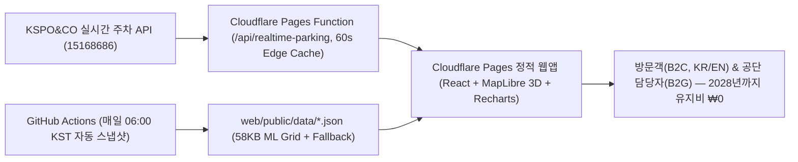

# Olpark Flow AI — 올림픽공원 공연·날씨·입출차 3D 혼잡 예측 & 게이트·ESG 분산 플랫폼

> **「2026년 한국체육산업개발(주) 공공데이터 활용 경진대회」 출품작**  
> **라이브 서비스 URL**: `[Cloudflare Pages 배포 후 입력 — 예: https://olpark-flow-ai.pages.dev]`  
> **라이선스**: MIT (서약서 제6항 원천 소스 제공 및 2028년 무중단 운영 완벽 대응)

---

## 1. 프로젝트 개요 및 차별화

범용 지도 앱(네이버지도·티맵 등)은 과거 단순 요일·시간대 평균만 제공하므로, 올림픽공원의 **대형 공연·동시 대관(최대 26,398명)** 특수일과 **내부 11개 세부 주차구역(`P1A~P11`) 간 극심한 공간 편중(`P11` 혼잡+만차 85.0% vs `P1A` 58.5%)**을 반영하지 못합니다.

**Olpark Flow AI**는 한국체육산업개발(주) 개방 공공데이터와 외부 기상·교통·환경 데이터를 융합해 **방문객 3D 도착 가이드(B2C, 한/영 지원)**와 **공단 대관·ESG 탄소 시뮬레이터(B2G)**를 단일 웹 URL로 제공하는 **유지비 ₩0 서버리스 디지털 트윈**입니다.

### 핵심 4-Tab 구성
1. **Tab 1 · 방문객 3D 도착 가이드 (`B2C + KR/EN`)**: 원클릭 대표 시나리오 칩 4종 + 시간 슬라이더(`06~23시`) 연동 **MapLibre GL JS 3D 올림픽공원·11개 주차구역 혼잡 기둥**, 안전 도착 마감 시각, 3개 지하철역(5·8·9호선) 귀가 분산 비교, 2026 글로벌 공연 원클릭 시뮬레이션.
2. **Tab 2 · 공단 B2G 대관·ESG 시뮬레이터**: 동시 대관 공연장 조합(KSPO DOME·핸드볼·올림픽홀·우리금융아트홀·88잔디마당·평화의광장) × 우천 스트레스 × 시차 입장/퇴장(`0/30/60분`) × 대중교통 전환율 조절 → **피크 부하 감축률·출차 대기 단축·공회전 CO₂ 절감량(소나무 환산)** 즉시 산출.
3. **Tab 3 · 2025 실측 AI 검증실 (`Backtest Lab`)**: 5개 모델(`Baseline / Ridge / RF / HGB / Ensemble`)의 **무누수 5-Fold Day-Grouped CV & 10~12월 미래 OOT Holdout** 비교표, 4대 실측 일자 오버레이, Permutation 변수 중요도, 11개 구역 공간 편중 차트 투명 공개.
4. **Tab 4 · 2028 무중단 & 데이터 품질 감사 (`Ops & DQ Audit`)**: 실데이터 전수 감사에서 적발한 **원천 품질 이슈 4건(`DQ-01 ~ DQ-04`)**과 공단 차년도 신규 개방·품질 개선 실무 제언 5건 수록.

---

## 2. 2025 실측 AI 예측 모델 백테스트 성과 (`5-Fold Day-Grouped CV`)

원천 데이터 품질 게이트(`DQ-01` XML CDATA 복원 · `DQ-02` 8~9월 75% 스케일 이상치 1,447행 격리) 통과 후 정제 **6,356시간(297일 · 공연일 113일)** 기준:

| 모델 | 주차 CV MAE (대) | 주차 CV RMSE (대) | 주차 CV $R^2$ | Peak MAPE (%) | 방문객 CV $R^2$ |
| :--- | :---: | :---: | :---: | :---: | :---: |
| Baseline (시간×주말 평균) | 295.63 | 493.56 | 0.6341 | 67.3% | 0.6875 |
| Ridge Regression | 308.19 | 472.67 | 0.6644 | 67.9% | 0.6644 |
| RandomForest (260 Trees) | 211.57 | 425.52 | 0.7280 | 44.8% | 0.7518 |
| HistGradientBoosting | 223.19 | 438.33 | 0.7114 | 46.3% | 0.7656 |
| **Ensemble (RF + HGB) ★** | **209.88 (`-29.0%`)** | **424.87** | **0.7288** | **44.4%** | **0.7667** |

---

## 3. 2028년 무중단 · 월 유지비 ₩0 서버리스 아키텍처



- **호스팅**: Cloudflare Pages 무료 플랜 (무제한 정적 트래픽 + 일 10만 회 Edge Function 무료)
- **AI 추론**: Python `scikit-learn` 학습 결과를 **58.7 KB JSON 그리드**로 컴파일 → 브라우저 내 0ms 클라이언트 추론 (GPU/백엔드 서버비 ₩0)
- **장애 복원력 (Graceful Fallback)**: 실시간 주차 API 일시 장애 시 `GitHub Actions`가 매일 갱신한 `realtime_parking.json` 스냅샷으로 자동 전환되어 404/에러 없음

---

## 4. 프로젝트 구조 & 로컬 실행

```text
ksponco-2026/
├── .github/workflows/refresh-data.yml  # 매일 06:00 KST 실시간 스냅샷 자동 갱신
├── pipeline/
│   ├── fetch_openapi.py                # culture.go.kr(XML CDATA 복원) & 실시간 주차 수집기
│   ├── run_csv_eda.py                  # CSV 6종 실측 EDA & 11개 구역 편중·CO2 베이스라인
│   └── train_model.py                  # RF+HGB 앙상블 학습·백테스트·웹 JSON/차트 생성
├── web/
│   ├── functions/api/realtime-parking.ts  # Cloudflare Pages Edge Proxy
│   ├── public/data/                    # 경량 추론 번들(58.7KB) + 이벤트 번들(14.2KB)
│   ├── src/                            # React + TypeScript + MapLibre 3D + Recharts
│   └── wrangler.toml                   # Cloudflare Pages 설정
└── docs/charts/                        # 백테스트·변수중요도·구역편중 고해상도 PNG 차트
```

### 로컬 실행
```bash
# 1. 웹 프론트엔드 실행
cd web
npm install
npm run dev   # http://127.0.0.1:5173

# 2. (선택) 데이터 파이프라인 재실행
cp .env.example .env   # culture.go.kr serviceKey 기입
python -X utf8 pipeline/fetch_openapi.py
python -X utf8 pipeline/run_csv_eda.py
python -X utf8 pipeline/train_model.py
```

### Cloudflare Pages 배포 설정 (GitHub 연동 기준)
- **Root directory**: `web`
- **Build command**: `npm run build`
- **Build output directory**: `dist`
- **Environment variables**: 불필요 (실시간 주차 공개키 내장, 무료 Edge Function 자동 인식)
